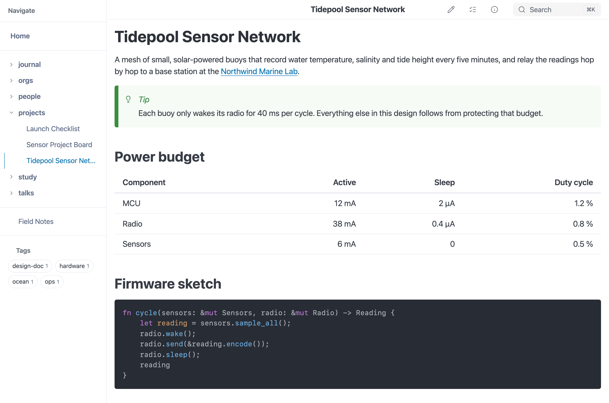

<div align="center">

# 

**The fast, complete markdown browser and static site generator**

  [](https://zmre.github.io/mbr-markdown-browser/)
[](https://github.com/zmre/mbr-markdown-browser/releases)
  
  
  [](https://github.com/zmre/mbr-markdown-browser/actions)
  [](LICENSE)
  [](https://crates.io/crates/mbr-markdown-browser)
</div>

---

## Why mbr?

> **No crazy syntax. No required directory structures. Just markdown.**

<p align="center">
  <picture>
    <source media="(prefers-color-scheme: dark)" srcset="docs/images/screens/hero-dark.png">
    
  </picture>
</p>

Most markdown viewers don't browse and are riddled with broken links because they don't understand the current project. And most static site generators force you into their world: custom folder layouts, proprietary frontmatter, bespoke shortcodes, and more. `mbr` takes a different approach. Point it at any collection of markdown files and it just works for previewing a single file, browsing thousands of notes, searching, navigating, or building a deployable website.

It's fast, keyboard-first, multi-purpose, customizable, and beautiful.  And it makes media embeds (images, videos, PDFs, etc.) first-class citizens.

Oh and on mac, it includes a quicklook plugin that's head and shoulders above any I've seen before.

## Features

| Feature                      | Description                                                                                                                                                                      |
|------------------------------|----------------------------------------------------------------------------------------------------------------------------------------------------------------------------------|
| **Instant Preview**          | Sub-second markdown rendering with live reload                                                                                                                                   |
| **Native GUI**               | macOS/Linux app with native menus and shortcuts (Windows binaries are built and tested in CI, but the GUI window itself is not exercised there)                                  |
| **Server**                   | `mbr -s` serves any folder of notes to a browser, locally or behind a proxy, with live reload and search                                                                         |
| **Mobile**                   | An iOS and iPadOS app (in development, in [`apple/ios`](apple/ios/)) that browses an iCloud, Dropbox, or local vault with the same engine and UI                                 |
| **Static Sites**             | Optionally generate deployable websites with full-text search                                                                                                                    |
| **Smart Navigation**         | Browse by folders, tags, recents, and full-text search                                                                                                                           |
| **Keyboard Friendly**        | Vim-like shortcuts for everything in the UI. Not sure what's available? Just press `?`                                                                                           |
| **Rich Media**               | Embed videos, audio, PDFs, and YouTube with simple markdown standard syntax                                                                                                      |
| **Slides**                   | Add `type: slides` to a note's frontmatter and present it as a reveal.js deck                                                                                                    |
| **Contacts & Relationships** | `type: person` and `type: organization` notes get contact cards, typed relationships, family trees, timelines, and org charts                                                    |
| **Flashcards**               | Give a note `type: flashcard` and study its definition lists in order, at random, or with spaced repetition                                                                      |
| **Tasks**                    | A task browser across every note, with due dates, priorities, and `TODO`/`FIXME` markers                                                                                         |
| **Fully Customizable**       | Override themes, templates, and UX per-repo                                                                                                                                      |
| **Editor**                   | mbr is primarily a viewer, but sometimes you just want a quick edit. On by default in the GUI and the iOS app; off for `mbr -s` unless you pass `--edit`; never in static builds |
| **QuickLook**                | On macOS, previews and thumbnails for markdown files in Finder                                                                                                                   |

## Quick Start

### Install

```bash
# macOS (Homebrew, Apple Silicon)
brew tap zmre/mbr https://github.com/zmre/mbr-markdown-browser
brew install --cask zmre/mbr/mbr

# Using Nix to quick run without installing
nix run --accept-flake-config github:zmre/mbr-markdown-browser -- /path/to/notes

# Using Cargo
cargo install --git https://github.com/zmre/mbr-markdown-browser
```

Or **download a pre-built binary** for macOS, Linux, or Windows from [Releases](https://github.com/zmre/mbr-markdown-browser/releases/latest).

`--accept-flake-config` opts in to the prebuilt binary cache. Without it Nix
ignores the substituters this flake declares and compiles everything from
source, which takes a while. See [Getting
Started](https://zmre.github.io/mbr-markdown-browser/getting-started/) to
configure it permanently — and for the one case where it does not help.

_File an issue if you want it packaged in a particular way._

### Run

```bash
mbr README.md         # Launch native GUI window
mbr -s ~/notes        # Start live web server at http://127.0.0.1:5200/
mbr -b ~/notes        # Build static site to ./build/
```

Editing is on in the GUI and off for the server. Use `mbr -s --edit` to edit through the server, or `mbr --no-edit` (or `edit_enabled = false` in `.mbr/config.toml`) to keep the GUI read-only. Editing on a non-loopback host requires a token (`mbr --generate-edit-token`). See [Editing](https://zmre.github.io/mbr-markdown-browser/modes/editing/).

## Documentation

See the [full documentation](https://zmre.github.io/mbr-markdown-browser/) for detailed guides. **The documentation site itself is built with mbr, serving as a live example of its capabilities.**

- [Getting Started](https://zmre.github.io/mbr-markdown-browser/getting-started/) - Installation and first steps
- [Modes of Operation](https://zmre.github.io/mbr-markdown-browser/modes/) - GUI, Server, Build, and QuickLook
- [Customization](https://zmre.github.io/mbr-markdown-browser/customization/) - Themes, templates, and components
- [Markdown Extensions](https://zmre.github.io/mbr-markdown-browser/markdown/) - Extended syntax reference
- [Architecture](https://zmre.github.io/mbr-markdown-browser/reference/architecture/) - Technical overview
- [Development](https://zmre.github.io/mbr-markdown-browser/reference/development/) - Building and contributing

## License

MIT - see [LICENSE](LICENSE) for details.
