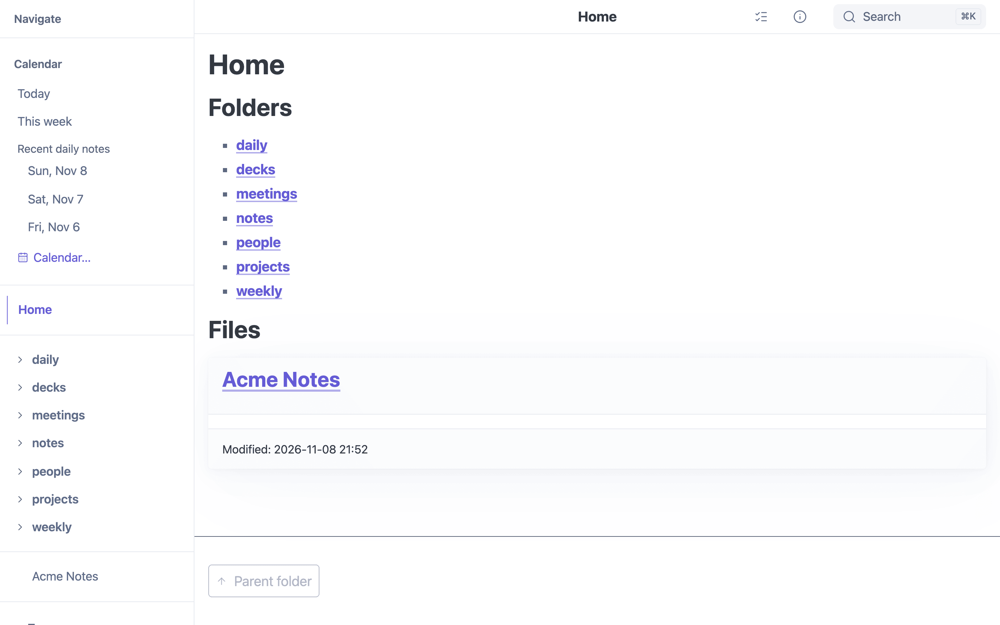

# Browsing

**Works in:** GUI · Server · Static site · iOS

mbr is built for moving around a collection of notes, not just reading one.
Everything here works in the GUI, in server mode and in static builds.

## File Browser Sidebar



*The docked sidebar (`sidebar_style = "single"`).*

Press **`-`** (minus key) to open the file browser sidebar. This is a three-pane navigator for exploring your entire markdown collection.

### Layout

```
┌──────────────────────────────┐
│  × Close                     │
├──────────────────────────────┤
│  🔍 Filter...                │
├──────────────────────────────┤
│  SHORTCUTS                   │
│    ⭐ My Important File      │
│    ⭐ Daily Notes            │
├──────────────────────────────┤
│  RECENT                      │
│    📄 guide.md               │
│    📄 notes.md               │
├──────────────────────────────┤
│  TAGS                        │
│    ▸ project (12)            │
│    ▸ review (5)              │
│    ▾ important               │
│        ▸ urgent (3)          │
├──────────────────────────────┤
│  FOLDERS                     │
│    ▸ docs/ (24)              │
│    ▸ notes/ (156)            │
│    ▾ projects/               │
│        ▸ website/ (8)        │
└──────────────────────────────┘
```

### Browser Sections

| Section | Description |
|---------|-------------|
| **Calendar** | Today's and this week's, month's, quarter's and year's periodic notes, recent daily notes, and the [calendar](calendar/#the-calendar-overlay) (only when the repository has periodic notes) |
| **Filter** | Quick text filter across all visible items |
| **Shortcuts** | Files you've pinned for quick access |
| **Recent** | Recently viewed files (persisted in localStorage) |
| **Tags** | Hierarchical tag tree with file counts |
| **Folders** | Directory structure mirroring your filesystem |

Selecting a folder or tag opens a second pane listing its notes. For a folder, the pane lists
the folder's direct subfolders first (with their note counts), then the notes directly inside
it; tapping a subfolder moves the pane into it and expands the folder tree to match. On a phone
the pane covers the tree, so this is how you walk down the folders. Long lists show 100 entries
at a time, with **Show more** to reveal the next 100. The note you are reading is marked with a
tinted card and an accent bar. The calendar button in the pane's header shows the whole selection
(a folder with its subfolders) on the [calendar](calendar/#the-calendar-overlay).

### Keyboard Shortcuts

| Key | Action |
|-----|--------|
| `-` | Toggle sidebar open/closed |
| `Escape` | Close sidebar |
| `↑` / `↓` | Navigate items |
| `Enter` | Open selected file or expand folder |
| `→` | Expand folder or tag |
| `←` | Collapse folder or tag |

### Pinning Shortcuts

Right-click any file in the browser to add it to your shortcuts. Shortcuts appear at the top for instant access to frequently used files.

To remove a shortcut, right-click it and select "Remove from shortcuts."

### Tag Hierarchy

Tags support hierarchical organization using `/` as a separator:

```yaml
---
tags: project/website, project/website/frontend
---
```

This creates a nested tag tree:
- project (parent)
  - website (child with count)
    - frontend (grandchild)

Click a parent tag to see all files with that tag or any descendant tags.

### Persistence

The browser remembers your preferences across sessions:

| Data | Storage | Cleared By |
|------|---------|------------|
| Recent files | localStorage | Clear browser data |
| Shortcuts | localStorage | Clear browser data |
| Expanded folders | Session only | Page refresh |
| Selected tags | Session only | Page refresh |

## Directory Browsing

Navigate your markdown repository:

- Folder listings with file counts
- Subdirectory navigation
- Breadcrumb trail for context
- Sort by name, date, or title

## Recent Files

mbr tracks recently viewed files (stored in browser localStorage), providing quick access to your working set.

## Breadcrumbs and Next/Previous

The breadcrumb trail under the header shows the folders above the page; each
is a link to that folder's listing. On a narrow screen it collapses to
"… › parent › page" and the "…" expands it.

| Key | Action |
|-----|--------|
| `L` (Shift+l) | Next note in this folder |
| `H` (Shift+h) | Previous note in this folder |

The order is the folder listing's, which [File Sorting](../customization/sorting/)
controls.

## See Also

- [Search](search.md) for finding notes by content and frontmatter
- [Links](links.md) for backlinks, the link explorer and the info panel
- [Tags](tags.md) for tag pages
- [Calendar](calendar.md) for daily and weekly notes
- [Keyboard Shortcuts](../reference/keyboard-shortcuts.md)
