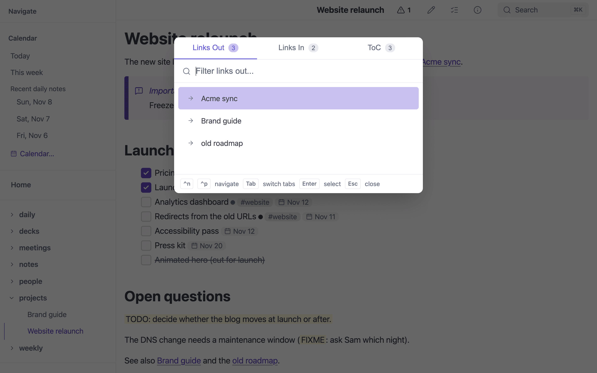
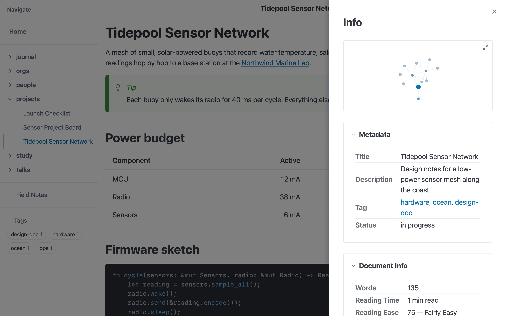
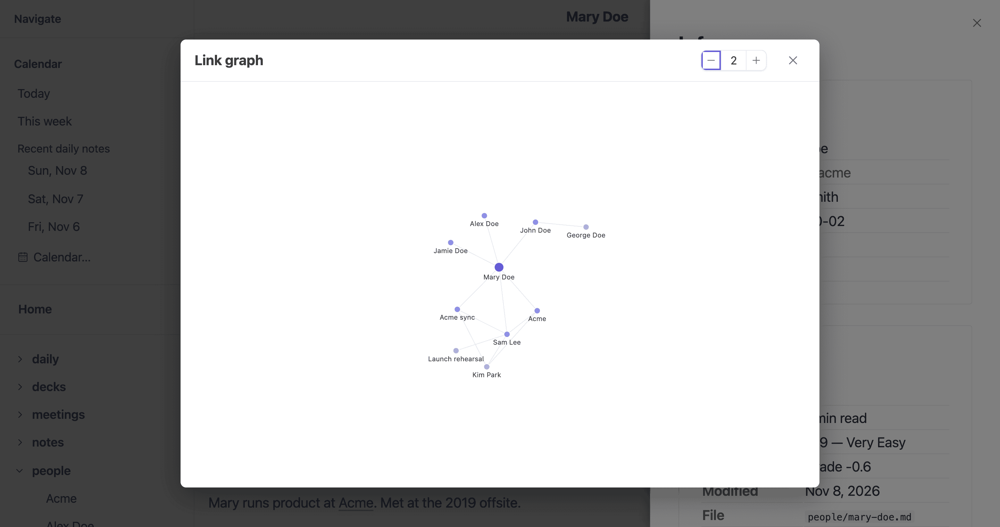
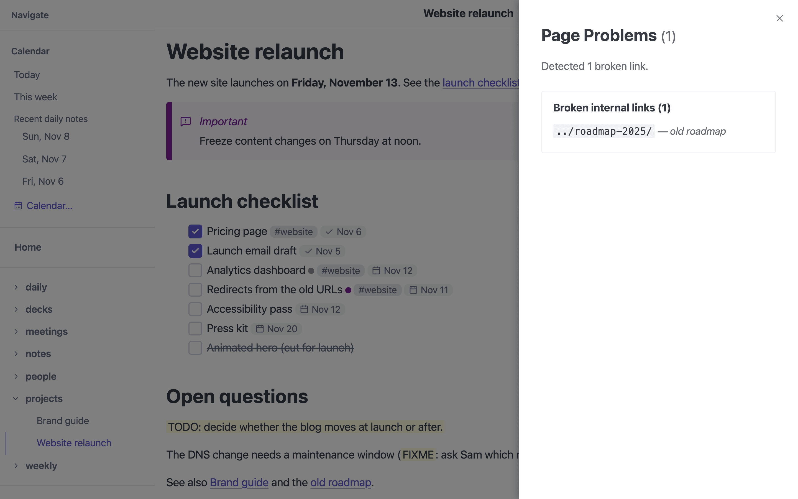

# Links, Backlinks and the Info Panel

**Works in:** GUI · Server · Static site · iOS

mbr keeps track of which notes link to which, in both directions, with no
special syntax: ordinary markdown links and [wikilinks](../markdown/links.md)
both count.

## Link Explorer



*The link explorer (`f`): links out, links in and the table of contents.*

Press **`f`**, **`F`**, or **`T`** to open the Link Explorer - a quick navigation modal for jumping between pages and headings.

### Tabs

| Key | Tab | Description |
|-----|-----|-------------|
| `f` | **Links Out** | All links from the current page to other pages |
| `F` | **Links In** | Backlinks - pages that link to the current page |
| `T` | **ToC** | Table of contents - all headings in the current document |

### Features

- **Fuzzy search** - Type to filter items with intelligent matching
- **Visibility awareness** - In ToC mode, currently visible headings are prioritized and marked
- **Internal vs External** - External links open in new tabs, internal links navigate in place. In [GUI mode](../modes/gui.md#external-links) there are no tabs, so external links go to your default browser instead
- **Link handling is your browser's** - Server mode never touches external links itself; see [External links](../modes/server/#external-links)
- **Tab cycling** - Press `Tab` to cycle between the three views

### Layout

```
┌──────────────────────────────────────────┐
│  [Links Out]  [Links In]  [ToC]          │
├──────────────────────────────────────────┤
│  🔍 Filter...                            │
├──────────────────────────────────────────┤
│  → Getting Started                       │
│  → Installation Guide                    │
│  → API Reference               ↗ (ext)   │
│  ← docs/intro (backlink)                 │
├──────────────────────────────────────────┤
│  ^n ^p navigate  Tab switch  Enter open  │
└──────────────────────────────────────────┘
```

### Keyboard Shortcuts

| Key | Action |
|-----|--------|
| `f` | Open Links Out tab |
| `F` (Shift+f) | Open Links In (backlinks) tab |
| `T` (Shift+t) | Open Table of Contents tab |
| `Tab` | Cycle to next tab |
| `Shift+Tab` | Cycle to previous tab |
| `↑` / `↓` | Navigate items |
| `Ctrl+n` / `Ctrl+p` | Navigate items (vim-style) |
| `Ctrl+d` / `Ctrl+u` | Scroll the list |
| `Enter` | Navigate to selected item |
| `Escape` | Close the explorer |

### Link Tracking

The Links Out and Links In tabs require link tracking to be enabled (default). This is controlled by the `link_tracking` config option:

```toml
# .mbr/config.toml
link_tracking = true  # default
```

When enabled, mbr automatically tracks:
- **Outbound links** - All markdown links `[text](url)` in the current page
- **Inbound links** - All pages that link to the current page (backlinks)

This enables wiki-style bidirectional link navigation without requiring any special syntax.

## The Info Panel



*The info panel (`Ctrl+G`): a mini link graph, frontmatter and document stats.*

Press **`Ctrl+G`** (on macOS too: `Cmd+G` is find-next), or use the info button
in the header, to open the info panel beside the page. Every section starts
expanded, and while the panel is open `j` / `k` and `Ctrl+d` / `Ctrl+u` scroll it.
It shows:

- a **link graph** of the page's neighbourhood: notes it links to and notes
  that link to it, two hops out by default
  ([`graph_depth`](../reference/configuration/#navigation-settings), 1–5);
  click a node to go there, or expand it to a full-size graph
- the page's **links out and in**
- its **relationships**, when it has any
  ([Relationships](relationships.md))
- its **frontmatter**, as a table
- **Copy page: Markdown · Rich**, which copies the whole note
  ([Copying](copying/))
- document stats, including the note's **File** path in the repository. In the
  [GUI](../modes/gui.md#finding-a-note-on-disk) a folder button beside the
  **File** label shows the file in Finder, Explorer or your Linux file manager
  (where it cannot, it copies the note's full path on disk). Server pages and
  static builds never show the full path

Press **`Ctrl+Shift+G`** to go straight to the full-size graph, whether or not
the panel is open; `Esc` closes it.

The graph needs link tracking; with `--no-link-tracking` the panel has no
graph section, and `Ctrl+Shift+G` says so instead.



*The link graph, expanded from the info panel.*

## Broken links

Links whose target does not exist are listed in the page-problems panel
(the ⚠ badge in the header, server and GUI), along with broken images and
other problems; see
[Per-Page Error Indicator](../reference/configuration/#per-page-error-indicator--server---gui-only).
Links to files outside the served folder are not broken links; see
[Links outside the folder](#links-outside-the-folder).

When a link's target is missing, the panel also offers up to three **Did you
mean** links: notes elsewhere in the site with the same name (the usual case
when a note was moved to another folder) or with a name that was extended or
shortened (`meeting` ↔ `meeting-notes`). Fix the link by hand, or follow one to
check it is the right note. Nothing is offered for a link that only lacks its
trailing slash: its target exists.

To list every broken link in the repository at once — with the same checks,
the source line of each, and the same suggestions written as ready-to-paste
replacements — run [`mbr --check-links-only`](../reference/cli.md#checking-links).
It builds nothing, prints a markdown todo list (or JSON with `--format json`),
and exits `1` when something is broken, so it also works as a CI check.

### When a page is not found

Following a link to a page that is gone shows mbr's 404 page, which suggests
where the page probably went:

- **Notes with the same name elsewhere** — the last part of the missing URL
  (`/work/project-plan/` → `project-plan`, an index note's folder name for
  `/clients/acme/index.md`) compared with every note's file name and URL,
  ignoring case and treating spaces, `-` and `_` alike. A missing PDF or image
  linked directly is looked for by its exact file name.
- **Notes whose name was extended or shortened** — `meeting` finds
  `meeting-notes` and `weekly-meeting-notes`, but never a name that merely
  contains it mid-word, and only for names of four or more characters.
- **Otherwise, its folder** — when nothing matches but the missing page's own
  folder still exists, the 404 page links to that folder and lists the notes
  directly in it. If the folder is gone too, nothing is suggested (it does not
  look further up; the page's Home button and search are there for that).

Matches that share more leading folders with the missing URL come first; at
most six are shown. Everything is computed in the browser from the site index,
so it works the same in the GUI, the server, the iOS app and a static build's
`404.html` (set [`base_url`](../reference/configuration.md#deployment-path)
when the site is published under a path, such as a GitHub project page).
A custom `.mbr/error.html` keeps working as before; it can add the suggestions
by including the [`_not_found_suggestions.html`](../customization/templates.md#404-suggestions)
partial.



*The page-problems panel.*

## Links outside the folder

Notes written in an editor often link to files anywhere on disk:

```markdown
[Ledgeline TODOs](~/src/sideprojects/ledgeline/TODO.md)
[Other repo](../../other-repo/README.md)
```

mbr serves only the folder it was opened on, so it never shows those files.
It does not treat them as broken links either. A link is **outside** when its
destination starts with `~` (`~` or `~/…`), or is a relative `../` path that,
resolved against the note's own location, climbs above the folder's root.
Deciding this needs only the text of the link: mbr never checks whether the
target exists, so a note cannot use mbr to find out which files are on your
disk. A link starting with `/` is not outside (in mbr `/x` means the site
root), and neither is `file://…`.

An outside link goes one of two ways:

- **Into a mount.** If the target lies inside a folder that a symlink in the
  repository points to (a read-only [symlink
  mount](../reference/configuration.md#read-only-symlink-mounts)), the link is rewritten to that file's
  place in the repository and works like any other link: `~/src/ledgeline/TODO.md`
  becomes `/ledgeline/TODO/` when `ledgeline` in your notes links to
  `~/src/ledgeline`. When several mounts contain the target, the most
  specific one wins.
- **Everywhere else**, the link opens a small page that names the target
  ("This note links to `~/src/…`, which is outside the folder this mbr is
  serving, so it can't be shown here") with a **Copy path** button. Such
  links carry a small ↱ arrow icon after them (see [Link
  icons](#link-icons)), and hovering one shows `External: <path>` instead
  of the page's address. They are not listed in the page-problems
  panel, are not counted by `--fail-on-broken-links`, and show up as
  external links in the link explorer and info panel.

In the **GUI**, that page also has an **Open…** button. It shows the usual
Open dialog in the target's folder (on macOS with the file selected where the
panel allows it). Whatever you choose there opens in the window **in place of
the current folder**, exactly like *File → Open…* (`Cmd/Ctrl+O`); cancelling
leaves everything as it was. mbr never opens the file by itself or hands it to
another application: the page could have been written by anyone, and handing
a `.command` or `.app` to the system would run it. The dialog is the step
where you decide. Server mode and the iOS app show the path and the copy
button only.

Static builds point these links at the same page (shipped as
`.mbr/outside/`). There, a `../` link is named relative to the repository's
root rather than by its full path, so a published site never reveals where it
was built. Images and other embedded media whose source is outside the folder
are not rewritten to that page; they simply do not load, unless they are in a
mount.

## Link icons

A link whose text is not its own address gets a small icon after it, so you
can tell where it goes before you click:

| Link | Example | Icon |
|------|---------|------|
| To another page or file in the folder | `[Setup](setup.md)` | none |
| To the internet (another site) | `[Docs](https://example.com/docs)` | globe |
| Out of the folder ([above](#links-outside-the-folder)) | `[TODOs](~/src/x/TODO.md)` | arrow turning right (↱) |

A bare link such as `<https://example.com>`, whose text already is the
address, gets no icon. Neither do image links, links in code blocks, heading
permalinks and footnote references. `mailto:` and other application links
are left as they are. The icons work in the GUI, server mode and static
builds; they are added shortly after the page loads.

Each link also gets a class you can style: `mbr-link-internal`,
`mbr-link-internet` or `mbr-link-outside` (`mbr-link-bare` for a bare link),
and a `data-mbr-link-kind` attribute (`internal`, `internet`, `outside`,
`other`) on every link. The icon is an empty `<span class="mbr-link-icon">`
inside the link, drawn by CSS in the link's own colour. mbr's rules have the
lowest possible specificity, so anything in `.mbr/user.css` wins:

```css
/* .mbr/user.css */

/* No link icons at all */
.mbr-link-icon { display: none; }

/* Only hide the globe on internet links */
.mbr-link-internet .mbr-link-icon { display: none; }

/* Use another icon for links out of the folder */
:root { --mbr-link-icon-outside: var(--mbr-icon-arrow-right); }
```

See [Theming](../customization/themes.md#icons-and-icon-buttons) for the
icon variables.
