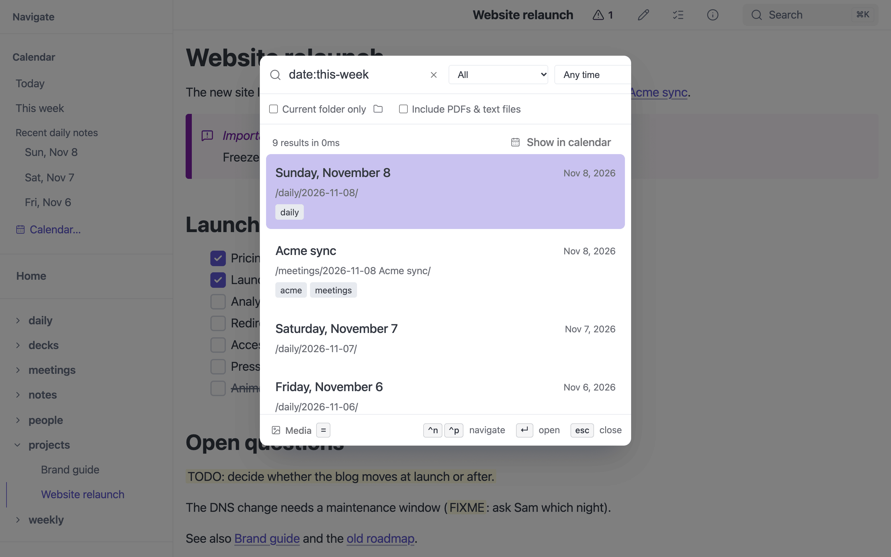

# Search

**Works in:** GUI · Server · Static site (Pagefind) · iOS (native search)

Press **`/`** (or `Ctrl+K` / `Cmd+K`), or click the search icon, to open the
search dialog. It works in the GUI, in server mode and in static builds.

- Search across all markdown files
- Filter by metadata, content, or both
- Filter on any frontmatter field with `field:value` (`tags:rust`,
  `company:acme`); quote values with spaces: `type:"Meeting Notes"`. Values
  match anywhere in the field (`company:acme` finds `Acme Corp`), except
  `type:`, which must match the whole type (`type:person` does not find
  `salesperson`); case never matters
- Pick a note type from the scope menu — every `type` in your notes is listed
  with a count, and choosing one writes the `type:` filter for you
- Scope to the current folder (on a note, the folder the note is in), to any
  folder via the folder button next to **Current folder only**, or everywhere
- Results show snippets with highlighted matches

See [Searching contacts](contacts/#searching-contacts) for examples.

## Search Features

| Feature | Description |
|---------|-------------|
| **Fuzzy matching** | Finds partial matches and typos |
| **Ranked results** | Best matches appear first |
| **Snippets** | Shows matching text with highlighted terms |
| **Metadata search** | Searches titles, tags, and descriptions |
| **Folder scoping** | Limit search to current directory |

## Search Syntax

| Query | Matches |
|-------|---------|
| `rust async` | Files containing both "rust" AND "async" |
| `"exact phrase"` | Files containing the exact phrase |
| `tag:project` | Files with the "project" tag |
| `title:guide` | Files with "guide" in the title |
| `when:-7d` | Notes dated, or modified, in the last 7 days (see [Search by date](#search-by-date)) |
| `date:2026-10` | Notes dated in October 2026 |

## Search by date

*`date:this-week`: each result shows the date it matched.*

Four facet keys take a **date expression** instead of text:

| Facet | Matches |
|-------|---------|
| `date:` | The note's date: its file name, else its frontmatter date, else when it was created (see [Note dates](calendar/#note-dates)) |
| `created:` | When the file was created |
| `modified:` | When the file was last changed |
| `when:` | `date:` **or** `modified:`: a note dated in the range, or changed in it |

A date expression is one of:

| Expression | Means |
|------------|-------|
| `2026`, `2026-10`, `2026-10-31`, `2026-W44`, `2026-Q4` | That whole year, month, day, ISO week or quarter |
| `2026-10-01..2026-10-15` | A range, both ends included. Either end may be any of the forms above, or left out: `2026-10..` (October 2026 onwards), `..2025` (up to the end of 2025). Reversed ends are swapped |
| `>=2026-10`, `>2026-10`, `<=2026-10`, `<2026-10` | From the start of a period, after its end, up to its end, before its start. Dates stop at 9999-12-31, so `>9999` matches nothing |
| `today`, `yesterday` | One day |
| `this-week`, `last-week` | An ISO week, Monday to Sunday (the [`week_start`](../reference/configuration/#calendar-settings) setting only lays out calendars) |
| `this-month`, `last-month`, `this-year` | A calendar month or year |
| `-30d`, `-2w`, `-3m`, `-1y` | The last 30 days, 2 weeks, 3 months or year, **today included**: `-7d` is today and the six days before it, and `-1m` on November 6 starts on October 7 |

"Today" is the date where you are: the search dialog sends your local date
with every query. Created and modified times become dates in the server's
time zone (in a static build, in yours).

Date facets combine with everything else: several facets must all match, and
`when:-7d type:meeting standup` finds meetings from the last week that
mention standup. With only date facets and no other words, results are
sorted by date, newest first; each result shows the date it matched on
("modified" or "created" when it was not the note's own date). Date facets
apply to markdown notes; with **Include PDFs & text files**, other files
match `created:` and `modified:` on their own times, and `date:`/`when:` on
their modification time. Tag pages have no date and drop out.

A value that is not a date expression (`date:draft`) is matched as text
against the frontmatter field of that name, as every other facet is.

The **When** menu beside the scope menu writes a `when:` facet for you: Any
time, Today, Last 7 days, Last 30 days, Last 3 months, Last 12 months, This
year, or Custom… (two dates, written as `when:2026-10-01..2026-10-15`). It
shows the preset a hand-typed `when:` matches, and Custom otherwise.

**Show in calendar**, beside the result count, opens the
[calendar](calendar/#the-calendar-overlay) on the results, by
note date. A search of only date facets is shown in full; any other search
shows the results listed.

## Keyboard Navigation

| Key | Action |
|-----|--------|
| `/` | Open search |
| `Escape` | Close search |
| `↑` / `↓` | Navigate results |
| `Enter` | Open selected result |

## In static builds

A static build has no server to search with, so `mbr -b` builds a
[Pagefind](https://pagefind.app/) index and the same dialog searches it in
the browser. Date facets still work there. See
[Search Configuration](../modes/build.md#search-configuration).

## Search API

`POST /.mbr/search` is documented in the [HTTP API](../reference/http-api/#search-api).
