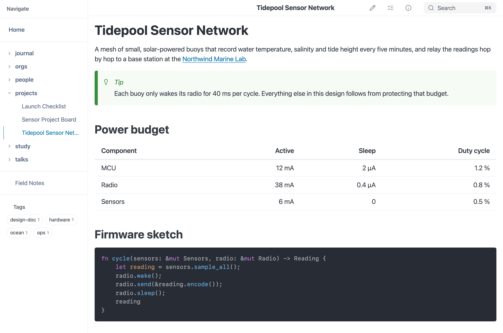
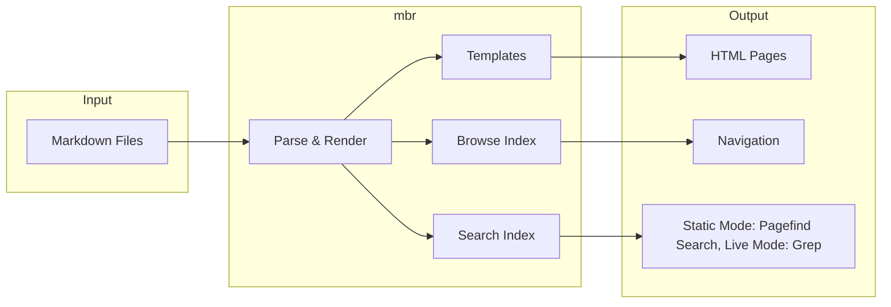

# mbr - Markdown Browser Documentation


**mbr** is a fast tool for browsing, previewing, and publishing markdown. Point it at any collection of markdown files - no custom syntax or directory structures required.



*A note in server mode, with the docked sidebar open.*

> [!NOTE]
> This documentation site is built with mbr. It serves as a live example of mbr's features including navigation like browsing and searching, and extended syntax like mermaid diagrams and embedded media. Browse around to see mbr in action. Use the browser on in the sidebar or hit slash (`/`) to search.  While on a page, hit `f` to get a list of outbound links to jump somewhere this page links to, or hit `F` to see links in.

## Quick Links

**Start here:** [Installation](getting-started/) · [Quick Start](getting-started/quickstart/)

**Running mbr:** [GUI](modes/gui/) · [Server](modes/server/) · [Static sites](modes/build/) · [QuickLook](modes/quicklook/) · [iPhone and iPad](modes/ios/) — compared in [Modes of Operation](modes/)

**Writing notes — [Markdown Syntax](markdown/):**

| Page | What it covers |
|------|----------------|
| [Frontmatter](markdown/frontmatter/) | Titles, tags, types, dates and your own fields |
| [Links and Wikilinks](markdown/links/) | Relative links, `[[wikilinks]]`, tag links |
| [Tasks](markdown/tasks/) | Checkboxes, priorities, due dates, `TODO:` markers |
| [Day Agenda Entries](markdown/agenda/) | `* 9:00 - 10:00 Standup` as a day timeline |
| [Alerts](markdown/alerts/), [Code](markdown/code/), [Diagrams](markdown/diagrams/), [Math](markdown/math/) | Callouts, highlighted code, mermaid, KaTeX |
| [Media](markdown/media/) | Video, audio, PDFs and embeds with image syntax |
| [Definition Lists](markdown/definition-lists/), [Sections](markdown/sections/), [Asides](markdown/asides/), [Chat](markdown/chat/) | FAQs, section attributes, pull quotes and sidenotes, chat transcripts |

**What mbr does with them — [Features](features/):**

| Page | What it covers |
|------|----------------|
| [Browsing](features/browsing/), [Search](features/search/), [Links](features/links/), [Tags](features/tags/) | Finding your way around |
| [Calendar](features/calendar/) | Daily, weekly and monthly notes, the day companion, the calendar overlay |
| [Task Browser](features/tasks/) | Every task in the repository, filtered and grouped |
| [Slides](features/slides/), [Flashcards](features/flashcards/), [Kanban](features/kanban/), [Page Styles](features/page-styles/) | Other ways to show a note |
| [Contacts](features/contacts/), [Relationships](features/relationships/) | People, organizations, family trees and org charts |
| [Editing](features/editing/), [Properties](features/editing-properties/), [Review Notes](features/review/) | Writing from the page |

**Making it yours:** [Customization](customization/) — themes, templates, components and sorting

**Reference:** [CLI](reference/cli/) · [Configuration](reference/configuration/) · [Keyboard Shortcuts](reference/keyboard-shortcuts/) · [HTTP API](reference/http-api/) · [Architecture](reference/architecture/) · [Development](reference/development/)

## What is mbr?

mbr is three tools in one:

1. **Markdown Previewer** - Render any markdown file instantly with live reload
2. **Markdown Browser** - Navigate folders, tags, and search across thousands of files
3. **Static Site Generator** - Build deployable websites with full-text search

### Key Principles

https://media1.giphy.com/media/v1.Y2lkPTc5MGI3NjExbG5udXhqcWpseDgyaGJ2bDd0MXRqYWVqYnY0b2MyMjRsbzU5cng5OSZlcD12MV9pbnRlcm5hbF9naWZfYnlfaWQmY3Q9Zw/izspP6uMbMeti/giphy.gif

- **Speed** - Sub-second rendering, instant navigation, fast site builds
- **No lock-in** - Works with any markdown repository without modifications
- **Customizable** - Override styles, templates, and components per-repository
- **Rich content** - Embed videos, audio, PDFs, diagrams, and more with native markdown image syntax that works magically with other media types
- **Zero run-time dependencies** - Everything is self-contained in a single binary

### Navigation Features

- **[File Browser](features/browsing/)** - Press `-` to open a sidebar with shortcuts, recent files, tag tree, and folder navigation
- **[Full-Text Search](features/search/)** - Press `/` to search across all files instantly
- **[Link Explorer](features/links/)** - Press `f` for outgoing links, `F` for backlinks, or `T` for table of contents
- **[Tag Hierarchy](features/tags/)** - Nested tags like `project/frontend` create browsable trees
- **Breadcrumbs** - Navigate up through the directory structure
- **[Next/Prev](features/browsing/#breadcrumbs-and-next-previous)** - Press `L` to go to the next file and `H` to go to the previous one
- **[Info](features/links/#the-info-panel)** - Press `Ctrl-g` to open an info window showing table of contents and frontmatter
- **[Task Browser](features/tasks/)** - Press `t` to find, filter and complete every task in the repository (server/GUI mode)
- **[Calendar](features/calendar/)** - Press `d` for today's daily note, `[` / `]` for the previous and next, `c` for the calendar overlay

## How It Works

Previewing: the mbr binary has built-in html template, css, and javascript defaults that are combined with html that derives from the current markdown file.  For any given repository of markdown files, there's a check for a `.mbr/` folder. The html templates, css, and javascript are fetched from there if they exist and fall back to the built-in defaults if they don't.

Exploring: in live mode (server or GUI), an initial file is rendered and in the background, an index of markdown files, assets, and metadata for each file (including frontmatter) is compiled and loaded into the GUI browser window.  That info is stored as a JSON file in a static build.  Also in static builds, full content search indices are generated, while in server and GUI mode content searches grep through files.



## Quick Example

```bash
# Preview a single file
mbr README.md

# Browse your notes with a web server
mbr -s ~/notes

# Launch a native GUI window
mbr -g ~/notes

# Build a static site
mbr -b ~/notes
```

## Customization at a Glance

Optionally create a `.mbr/` folder in your markdown repository to customize how a given repository is handled and presented:

```
your-notes/
├── .mbr/
│   ├── config.toml    # Configuration
│   ├── theme.css      # Replace the default theme
│   └── user.css       # Add or override select styles
├── whatever.md
└── subdir/
    └── important-note.md
```

See [Customization](customization/) for the full guide.
