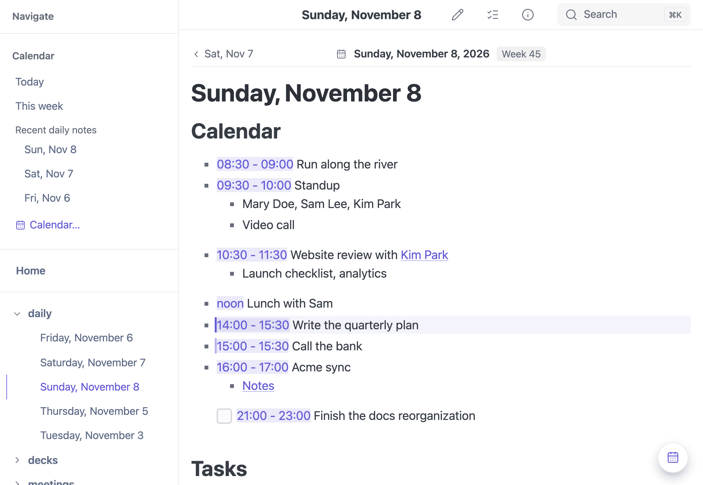
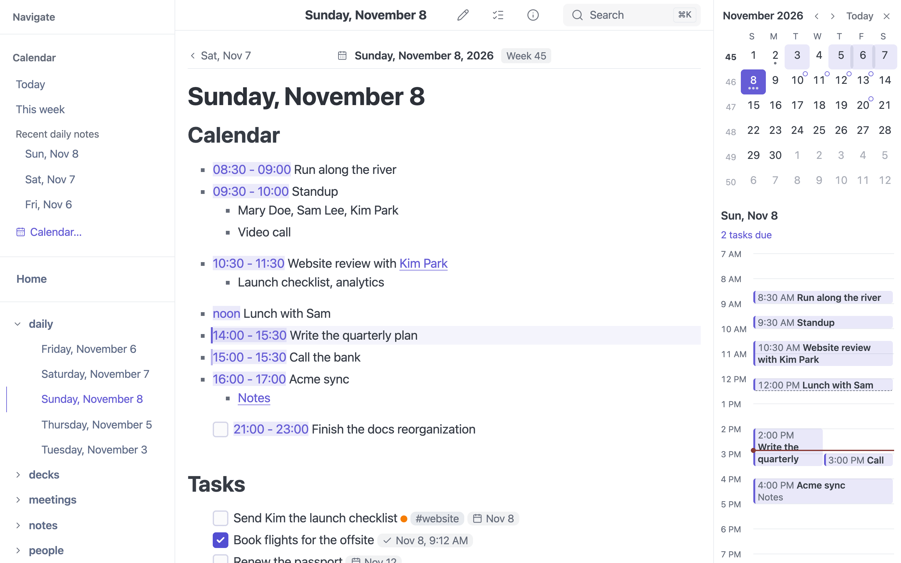

# Day Agenda Entries

Start a list item with a time and it becomes an **agenda entry**. mbr tints the
time in the page, draws the day's entries as a timeline in the
[day companion](../features/calendar/#the-daily-note-companion) and in
[QuickLook](../modes/quicklook/#day-calendar), and marks what is happening now on
today's note. Nothing in the file changes: it is an ordinary markdown list that
any other tool reads as a list.

```markdown
## Calendar

* 09:00 - 09:15 Standup
    * Employees, Bob Wall, Patrick Walsh
    * Slack call / Google Hangout
* 10:30 - 11:00 Bob / Patrick 1:1
    * Hangouts
* noon Lunch with Sam
* 2pm Dentist
- [ ] 16:00 - 16:30 Write the weekly update
```



*In the note, each time is tinted and the entry in progress is marked.*

Live:

* 09:00 - 09:15 Standup
    * Employees, Bob Wall, Patrick Walsh
    * Slack call / Google Hangout
* 10:30 - 11:00 Bob / Patrick 1:1
    * Hangouts
* noon Lunch with Sam
* 2pm Dentist

The entries work in **any** note. A daily note (`2026-11-08.md`) is the common
place for them, but a meeting note, a travel itinerary or a log of
`07:30 BP 118/76` readings works too.

## The rules

An entry is a **top-level list item** (any bullet, `-`, `*`, `+`, `1.` or
`1)`) whose text **starts with a time or a time range**, followed by a title.

**The time.** Case does not matter:

| Form | Examples |
|------|----------|
| 24-hour | `09:00`, `9:00`, `14:30` |
| Dotted (Obsidian Day Planner) | `09.00`, `14.30` |
| 12-hour | `9am`, `9 am`, `9:30pm`, `9:30 p.m.` |
| Words | `noon`, `midnight` |
| Ranges | `09:00 - 10:00`, `9:00–10:00`, `9am to 10:30am`, `5:00pm-6pm` |
| A leading word | `at 3pm Call the bank`, `from 9am to 10am Workshop` |

**Between the time and the title** comes a space, or `:` or a dash and a space:
`14:00 Lunch`, `14:00: Lunch` and `14:00 - Lunch` are the same entry.

**Ranges.** An end without am/pm takes the start's: `1pm - 2:30` ends at 14:30.
An end at or before the start is ignored, and the entry has a start only. An
entry with no end is drawn as half an hour, with a dashed edge.

**Details.** Bullets nested under an entry are its details (who, where, a
dial-in link). The companion shows them under the entry's title. They are not
entries themselves, even if they start with a time.

**Tasks.** A task item is an entry when its text starts with a time:
`- [ ] 10:00 - 10:30 Call the bank`. The timeline shows its checkbox state, and
it is still an ordinary [task](tasks/) everywhere else.

**Formatting is fine.** `- **09:00** Standup` is an entry: mbr reads the text
as the page shows it, not the markdown source.

## What is not an entry

| Line | Why not |
|------|---------|
| `- 2026 goals` | A year is not a time |
| `- 10 reasons to switch` | A bare number is not a time |
| `- 1:1 with Bob` | Minutes need two digits |
| `- 10:30am-ish coffee` | The time has to end cleanly |
| `- 09:00` | No title |
| A list nested inside another list | Only top-level items count; nested ones are details |
| A list inside a quote, a table, a `<details>` block or a ```` ```chat ```` block | Not top-level |
| `09:00 Standup` in a paragraph or heading | Only list items count |

## What you see



*The day companion draws the entries as a timeline, with a red line at the current time.*

**In the note.** Each entry's time gets a subtle tint. On **today's** day note,
the entry in progress and the next one are marked at the left edge, updated
every minute. The tint is drawn without changing the page's text (with the CSS
Custom Highlight API), so copying, searching and find-in-page see the text
exactly as written; browsers without that API show no tint.

**In the day companion.** On a day note the companion's **day agenda** draws
the entries as a timeline, from 8:00 to 18:00 or wider when the day runs
longer. Overlapping entries sit side by side, and on today a red line marks the
current time. Click a day in the companion's mini month and you see *that*
day's agenda, read from its note. On a note that is not a day note, the
companion lists **Times in this note** instead. See
[The daily-note companion](../features/calendar/#the-daily-note-companion).

**In QuickLook.** Pressing Space on a note in Finder shows the note's day beside
it: the date, a mini month and the same timeline. See
[QuickLook: Day calendar](../modes/quicklook/#day-calendar).

**Links to an entry.** Each entry gets an anchor, `#mbr-agenda-1` for the
first, `#mbr-agenda-2` for the second, and so on. Clicking an entry in the
companion scrolls to it, or opens another day's note at that entry.

## Which day the entries belong to

The entries take the **note's date**: from the file name (`2026-11-08.md`,
`2026-11-08 Acme sync.md`), else the frontmatter `date` or `created`, else when
the file was created. See [Note dates](../features/calendar/#note-dates). A
note with no date of its own still shows its entries in the companion, under
**Times in this note**, without claiming a day for them.

## Turning it off

| Setting | Effect |
|---------|--------|
| `[calendar] agenda_chips = false` | No time tint or now/next marker in the page |
| `[calendar] companion = "on-demand"` | The companion never docks; `C` or the calendar button opens it |
| `[calendar] companion = "off"` | No companion |
| `[calendar] enabled = false` | No calendar features at all |

See [Calendar Settings](../reference/configuration/#calendar-settings).

## Compatibility

| Tool | Notes |
|------|-------|
| Obsidian Day Planner | `- 09:00 - 10:00 Title` and `09.00` read as written |
| Logseq, bullet journals | Plain `- 9am Title` bullets work |
| Org mode | `SCHEDULED:` lines are [task dates](tasks/#dates-from-other-tools), not agenda entries |
