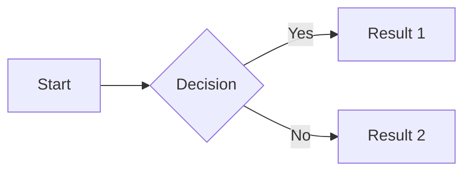
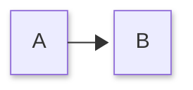

# Mermaid Diagrams

Code blocks with `mermaid` language render as diagrams:

````markdown

````

Renders as:


## Supported Diagram Types

- Flowcharts (`graph` or `flowchart`)
- Sequence diagrams (`sequenceDiagram`)
- Class diagrams (`classDiagram`)
- State diagrams (`stateDiagram`)
- Gantt charts (`gantt`)
- Pie charts (`pie`)
- And more...

## Layout and Look

mbr renders diagrams with the `dagre` layout and the `classic` look. Mermaid 12
made ELK and the `neo` look its defaults; mbr keeps the earlier ones so that
existing diagrams do not change shape or colour, and because dagre is the faster
layout. A single diagram can opt in with Mermaid's own front matter:

````markdown

````

See [Mermaid documentation](https://mermaid.js.org/) for full syntax.
