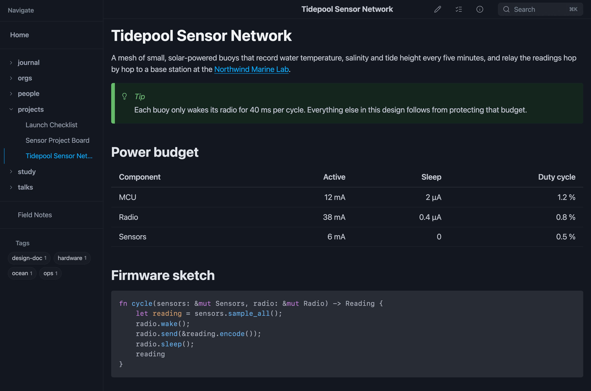

# Markdown Syntax

This section is about what you **type**. mbr reads standard CommonMark and
GitHub-flavored markdown with every
[pulldown-cmark](https://github.com/raphlinus/pulldown-cmark) extension turned
on, and adds a few constructs of its own. None of it is required: a plain
markdown file renders as you would expect, and everything below stays readable
in any other editor.

What mbr *does* with your notes (slides, flashcards, the task browser, the
calendar, contacts) is under [Features](../features/).



*Callouts, tables and highlighted code, here in dark mode.*

## At a glance

| Syntax | Looks like | Page |
|--------|-----------|------|
| Frontmatter | `---` / `title: …` / `---` at the top | [Frontmatter](frontmatter/) |
| Links and wikilinks | `[text](other.md)`, `[[Other Note]]`, `[[Tags:rust]]` | [Links and Wikilinks](links/) |
| Alerts | `> [!NOTE]`, `!> tip` | [Alerts](alerts/) |
| Tasks | `- [ ] Call Bob !! @due(2026-11-10) #work`, `TODO:` | [Tasks](tasks/) |
| Agenda entries | `* 9:00 - 10:00 Standup` | [Day Agenda Entries](agenda/) |
| Code | ```` ```rust ```` | [Code Blocks](code/) |
| Diagrams | ```` ```mermaid ```` | [Mermaid Diagrams](diagrams/) |
| Math | `$x^2$`, `$$…$$`, ```` ```latex ````, ```` ```asciimath ```` | [Math](math/) |
| Pull quotes | `>> quote` | [Pull Quotes, Marginalia and Footnotes](asides/) |
| Marginalia | `>>> sidenote` | [Pull Quotes, Marginalia and Footnotes](asides/#marginalia--sidenotes) |
| Footnotes | `text[^1]` + `[^1]: note` | [Pull Quotes, Marginalia and Footnotes](asides/#footnotes) |
| Definition lists | `Term` + `: definition` | [Definition Lists (FAQ)](definition-lists/) |
| Section attributes | `--- {#intro .dark}` | [Section Attributes](sections/) |
| Images, video, audio, PDF | `` | [Media](media/) |
| Embeds | a bare YouTube, Giphy or web URL on its own line | [Media](media/#youtube-embedding) |
| Chat transcripts | ```` ```chat ```` | [Chat Transcripts](chat/) |

Standard pulldown-cmark extensions, each documented upstream:
[tables](https://pulldown-cmark.github.io/pulldown-cmark/third_party/gfm_table.html),
[footnotes](https://pulldown-cmark.github.io/pulldown-cmark/specs/footnotes.html),
[strikethrough](https://pulldown-cmark.github.io/pulldown-cmark/third_party/gfm_strikethrough.html),
[task lists](https://pulldown-cmark.github.io/pulldown-cmark/third_party/gfm_tasklist.html),
[smart punctuation](https://pulldown-cmark.github.io/pulldown-cmark/third_party/smart_punct.html),
[heading attributes](https://pulldown-cmark.github.io/pulldown-cmark/specs/heading_attrs.html),
[math](https://pulldown-cmark.github.io/pulldown-cmark/specs/math.html),
definition lists and
[wikilinks](https://pulldown-cmark.github.io/pulldown-cmark/specs/wikilinks.html).

The small ones are covered right here.

## Tables

GFM-style tables with alignment:

```markdown
| Left | Center | Right |
|:-----|:------:|------:|
| A    |   B    |     C |
| D    |   E    |     F |
```

| Left | Center | Right |
|:-----|:------:|------:|
| A    |   B    |     C |
| D    |   E    |     F |

A table wider than the page scrolls sideways by itself instead of widening the
page.

## Strikethrough

`~~deleted text~~` renders as ~~deleted text~~.

## Smart Punctuation

Straight quotes become curly ("quotes", 'quotes'), `--` becomes an en dash,
`---` within a line an em dash, and `...` an ellipsis. Code spans and code
blocks are left alone.

## Heading Anchors

Every heading gets an anchor id:

```markdown
## My Section
```

links as `#my-section`. Set your own, or add classes, with heading attributes:

```markdown
## My Section {#custom-id .highlight}
```

Hover a heading to reveal its `#` permalink.

## Auto-linking

URLs in angle brackets become clickable:

```markdown
<https://example.com>
<user@example.com>
```

A bare URL alone on its own line becomes an embed instead; see
[Media](media/#youtube-embedding).

## Raw HTML

HTML in a note is passed through, so `<details>`, `<kbd>`, `<picture>` and the
like all work. Relative `src` and `href` values in it are resolved like
markdown links (see [Links](links/)).
