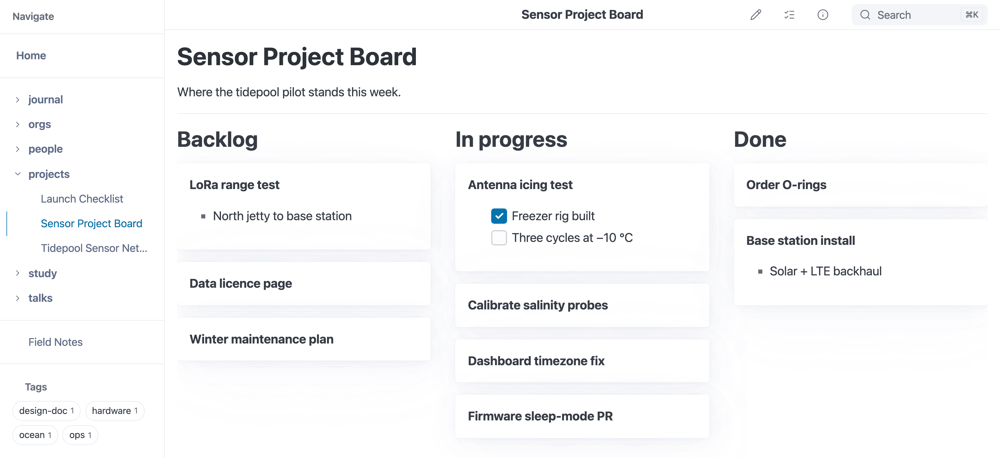

# Kanban Display

You can make a section of a note display as trello-like kanban columns, where each heading is a column and each bullet in the list under it is a card. Start the section with a `--- {.kanban}` divider (see [section attributes](./#section-attributes) if that syntax is new) and end it with a plain `---` or the end of the file.  Here's a quick example:



*A `--- {.kanban}` section: each heading is a column and each bullet a card.*

```markdown
--- {.kanban}

## Backlog

* Semantic search (or hybrid)
  * Local
  * Client-side
* Browser tag filters
* Knowledge cluster visual browsing
  * Via tags, semantic meanings, folders, links (in/out), etc.

## On deck

* Upgrade to pagefind 1.5 when released
* Add benchmarks to track performance
  * [x] Explorer to understand changes over time
  * [x] Static build and live previewer
  * [ ] Automated benchmarking on release via CI
* Small text variant for slides
* Video demos

## In progress

* Kanban display
  * Pure CSS
  * Existing syntax -- no new parsing or HTML
* Something else
  * Lorem ipsum dolor sit amet, consectetur adipisicing elit, sed do eiusmod tempor incididunt ut labore et dolore magna aliqua. Ut enim ad minim veniam, quis nostrud exercitation ullamco laboris nisi ut aliquip ex ea commodo consequat. Duis aute irure dolor in reprehenderit in voluptate velit esse cillum dolore eu fugiat nulla pariatur. Excepteur sint occaecat cupidatat non proident, sunt in culpa qui officia deserunt mollit anim id est laborum.

## Completed

* Quicklook previews

---
```

This is just for display -- if you want to move items, do it in the editor.  Here's what the above markdown renders like (note: you may need to scroll horizontally):

--- {.kanban}

## Backlog

* Semantic search (or hybrid)
  * Local
  * Client-side
* Browser tag filters
* Knowledge cluster visual browsing
  * Via tags, semantic meanings, folders, links (in/out), etc.

## On deck

* Upgrade to pagefind 1.5 when released
* Add benchmarks to track performance
  * [x] Explorer to understand changes over time
  * [x] Static build and live previewer
  * [ ] Automated benchmarking on release via CI
* Small text variant for slides
* Video demos

## In progress

* Kanban display
  * Pure CSS
  * Existing syntax -- no new parsing or HTML
* Something else
  * Lorem ipsum dolor sit amet, consectetur adipisicing elit, sed do eiusmod tempor incididunt ut labore et dolore magna aliqua. Ut enim ad minim veniam, quis nostrud exercitation ullamco laboris nisi ut aliquip ex ea commodo consequat. Duis aute irure dolor in reprehenderit in voluptate velit esse cillum dolore eu fugiat nulla pariatur. Excepteur sint occaecat cupidatat non proident, sunt in culpa qui officia deserunt mollit anim id est laborum.

## Completed

* Quicklook previews

---

This is useful for tracking projects, issues, tasks, etc., and seeing them in a more visual way, and the markdown stays standard: a list of headings and bullets with one divider line in front.

## A Whole File as a Board

There is no page-wide switch: a board is always a `--- {.kanban}` section. To make a whole note a board, put the divider right after the frontmatter, or after a title and any introduction you want above the board. Headings inside the section become columns, so keep the note's `#` title above the divider:

```markdown
---
title: Project board
---
# Project board

--- {.kanban}

## Backlog

* Write the proposal

## Done

* Pick a name
```

> [!WARNING]
> Do not put `style: kanban` in the frontmatter. Frontmatter styles become classes on the page's `<body>`, and the kanban rules apply to whatever element carries the class. On `<body>` they pour the whole page -- header, note and footer -- into narrow columns 85% of the window tall, while the lists stay plain bulleted lists, because the card rules only match lists directly inside the board. It does not help a page that also has a `--- {.kanban}` section either: the section still becomes a board, but the page around it is broken the same way.

## How the Board Lays Out

The board is CSS multi-column layout, so it takes no JavaScript and no new markdown syntax:

* The board is 85% of the window tall, and each column is about 18rem wide, with as many columns as the headings need.
* Columns that do not fit the width of the page scroll sideways inside the board.
* A column whose cards are taller than the board continues at the top of the next column, and every column after it moves one place to the right. Keep each list short enough to fit, or split it under a second heading.
* Each item of a top-level list in the section is a card. Nested bullets, checklists and text inside an item are that card's content, in normal weight under the card's bold first line.

## Printing

When printed, a board flattens to a single column: each heading is followed by its list of cards, so every card reaches the page instead of being cut off at the board height or the sheet width.
