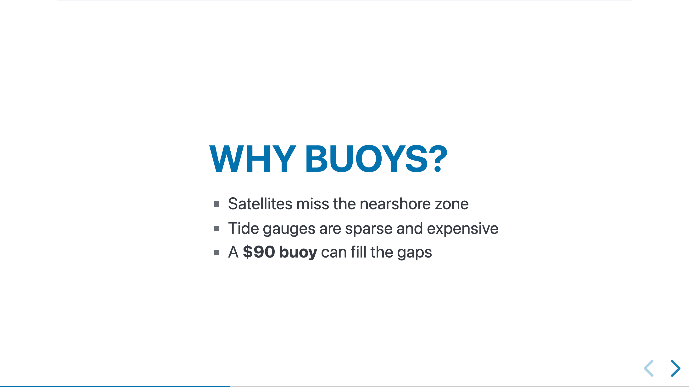

# Presentation Slides

mbr can transform any markdown document into a presentation using [Reveal.js](https://revealjs.com/).



*A `type: slides` note playing as a Reveal.js deck.*

## Quick Start

Add `type: slides` to your frontmatter:

```yaml
---
title: My Presentation
type: slides
---
```

> [!NOTE]
> `style: slides` still works and always will. Both fields feed the page's body
> class, so existing decks keep rendering unchanged. `type` is now the preferred
> spelling, because a deck is a kind of note rather than a coat of paint. See
> [Page Styles and Types](styles/). In the in-browser editor, `type` is
> suggested with `slides` among its values
> ([Editing Properties](../modes/editing-frontmatter/#choosing-a-type)).

Use horizontal rules (`---`) to separate slides. Only the `---` block at the
very top of the file is frontmatter; every later `---` is a slide break, even
when a heading or a list follows it directly:

```markdown
---
title: My Presentation
type: slides
---

# Welcome

First slide content

---

## Second Slide

- Point one
- Point two

---

## Conclusion

Final slide
```

## Playing the Slides

Click **Play** in the header, or press `p`. On phones (600px wide or
less) and in the iOS app, the header button gives way to a floating play button in
the bottom-right corner that starts the slides. While the slides play, the iOS app hides its navigation
bar and the status bar so the deck gets the whole screen, and turns off its
back/forward edge swipes so a swipe changes slides instead of leaving the page.

### Leaving the slides

Press `q`, or click the ✕ in the bottom-left corner, to leave the presentation
and get the page back. The ✕ is almost invisible while you present, and shows
up when you point at it or tab to it; on a touch screen, which cannot hover, it
stays visible. In the iOS app the ✕ also brings the navigation bar back.

### Reloading keeps you in the slides

While the slides play, the address bar carries the slide you are on
(`#/0` for the first slide, `#/3` for the fourth, and so on). Reloading the page,
whether by hand or because mbr reloaded it after you saved the file, brings the
presentation back on that same slide, so you can edit a slide and see the change
straight away. A link to the page with a slide hash opens the presentation too.
`q` and the ✕ drop the hash, so the page you return to is the ordinary page.

### Fitting the slides

Each slide is shown in a fixed 960×700 box that is scaled to the window. A slide
whose content is taller than that box is fitted to it while it is on screen:
images are first shrunk to the room the text leaves (never below about a third
of the slide), and then, if the slide still does not fit, its text gets
smaller, down to half size. A slide that still does not fit at half size
scrolls. Text and an image together are centred like any other slide, and
images are loaded before their slide appears, so a slide does not move when its
picture arrives.

A phone shows the same slides as a desktop, scaled down to fit the screen,
so a deck's own CSS, backgrounds, images and diagrams look the way they do on
a large display. Turn the phone sideways for bigger slides. (reveal.js would
otherwise switch narrow screens to a scrolling layout that rearranges the
slides; mbr turns that off.) If the page has diagrams, Play waits until they
are drawn before starting.

## Speaker Notes

Use triple blockquotes (`>>>`) for speaker notes visible only to the presenter (press `s` for speaker view):

```markdown
## Slide Title

Content visible to audience.

>>> These notes are only visible in the speaker view.
>>> Press 'S' to open the speaker notes window.
```

## Slide Attributes

Add attributes to individual slides using the section attributes syntax:

```markdown
--- {#intro .dark-bg data-transition="zoom"}

This slide has:
- ID: intro
- Class: dark-bg
- Transition: zoom

--- {.centered}

This slide has centered class
```

### Slide Backgrounds

Reveal.js background attributes work too, and their paths resolve exactly like
image links on the same page, relative to the markdown file. You don't have to
account for the trailing-slash URL a page is served at, and static-folder
images, nested folders and static builds all behave the same as with ``:

```markdown
--- {data-background-image="images/title-bg.jpg" data-background-size="cover"}

--- {data-background-video="media/loop.mp4,media/loop.webm" data-background-video-loop="true"}

--- {data-background="images/texture.png"}

--- {data-background="#336"}
```

mbr rewrites `data-background-image`, `data-background-iframe`, each entry of
`data-background-video`'s comma-separated list, and the `data-background`
shorthand when it is an image URL. Colours and gradients (`#336`, `red`,
`linear-gradient(...)`) and absolute URLs (`https://...`, `data:...`) are left
as written. A background image or video that doesn't exist shows up in the
page's error panel, the same as a broken image.

### Media Beside Text

Give a slide the `media-float-right` or `media-float-left` class to put its
image or embed on one side, up to half the slide's width, with the heading's
bullets and paragraphs beside it:

```markdown
--- {.media-float-right}

## Why buoys?


- Cheap to deploy
- Report every ten minutes
```

This works for images, videos, audio, PDFs, YouTube links and Giphy links,
all written with the usual `` syntax. Video, audio, PDF and YouTube
take the full half; images and GIFs keep their own size up to it. A floated PDF
is shown square, so it doesn't fill the slide. Figure captions are hidden while
the slides play. The classes work on ordinary pages too (see
[Floating Media Beside Text](media/#floating-media-beside-text)).

## Keyboard Shortcuts

While the slides play, the keyboard belongs to them: mbr's own page shortcuts
(search, the file browser, `f` for links, `j`/`k` scrolling and the rest) are
off until you leave, so they cannot open panels behind the slides. `r` still
adds a [review note](../modes/review/) to text you select on a slide, and keys
typed into the note form go to the form, not to the slides.

| Key | Action |
|-----|--------|
| `->` / `Space` / `n` | Next slide |
| `<-` / `p` | Previous slide |
| `Esc` / `O` | Overview mode |
| `s` | Speaker notes |
| `g` | Jump to a slide by number |
| `f` | Fullscreen |
| `b` / `.` | Pause (black screen) |
| `q` | Exit the slides |
| `?` | Help: every slide shortcut, `q` included |

## Tips

- **Images**: Use standard markdown image syntax
- **Code blocks**: Syntax highlighting works automatically
- **Math**: KaTeX equations render in slides, including ` ```latex ` / ` ```math ` / ` ```asciimath ` [math fences](index.md#multi-line-math-with-fenced-blocks)
- **Mermaid**: Diagrams work in presentation mode
- **Kanban boards**: a `--- {.kanban}` slide shows its board as columns of
  cards side by side, one column per heading and its list, the same as on the
  page (see [Kanban Display](kanban/)). A board too tall for the slide gets
  smaller text, like any other slide.

## Example

Use a [live example](test-slides/).

Create a test presentation:

```markdown
---
title: Test Presentation
type: slides
---

# Welcome

This is the title slide

>>> These are speaker notes for the title slide.
>>> Press 'S' to open the speaker notes window.

---

## Slide Two

- Point one
- Point two
- Point three

>>> Remember to emphasize point two!

---

## Code Example

 ```rust
 fn main() {
     println!("Hello slides!");
 }
⎜```

--- {#conclusion .highlight}

## Conclusion

Thanks for watching!

>>> Final remarks: thank the audience.
```
