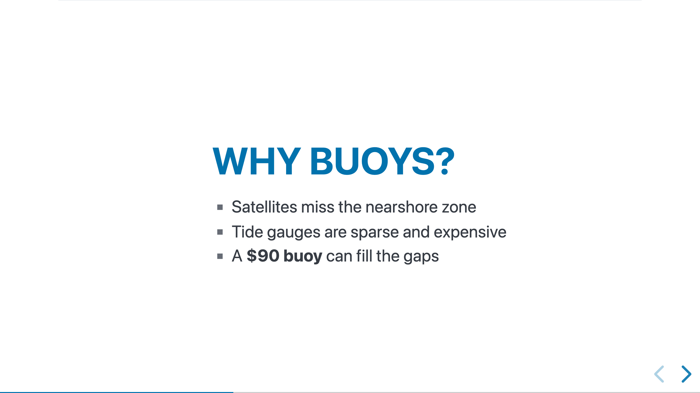

# Presentation Slides

mbr can transform any markdown document into a presentation using [Reveal.js](https://revealjs.com/).



*A `type: slides` note playing as a Reveal.js deck.*

## Quick Start

Add `type: slides` to your frontmatter:

```yaml
---
title: My Presentation
type: slides
---
```

> [!NOTE]
> `style: slides` still works and always will. Both fields feed the page's body
> class, so existing decks keep rendering unchanged. `type` is now the preferred
> spelling, because a deck is a kind of note rather than a coat of paint. See
> [Page Styles and Types](styles/). In the in-browser editor, `type` is
> suggested with `slides` among its values
> ([Editing Properties](../modes/editing-frontmatter/#choosing-a-type)).

Use horizontal rules (`---`) to separate slides:

```markdown
---
title: My Presentation
type: slides
---

# Welcome

First slide content

---

## Second Slide

- Point one
- Point two

---

## Conclusion

Final slide
```

## Playing the Slides

Click **Play** in the header, or press `p`. On phones (600px wide or
less) and in the iOS app, the header button gives way to a floating play button in
the bottom-right corner that starts the slides. There, a small ✕ button in the
bottom-left corner leaves the presentation and reloads the page, since a touch
screen has no `Esc`. While the slides play, the iOS app hides its navigation
bar and the status bar so the deck gets the whole screen, and turns off its
back/forward edge swipes so a swipe changes slides instead of leaving the page.
The ✕ brings the bar back.

A phone shows the same slides as a desktop, scaled down to fit the screen,
so a deck's own CSS, backgrounds, images and diagrams look the way they do on
a large display. Turn the phone sideways for bigger slides. (reveal.js would
otherwise switch narrow screens to a scrolling layout that rearranges the
slides; mbr turns that off.) If the page has diagrams, Play waits until they
are drawn before starting.

## Speaker Notes

Use triple blockquotes (`>>>`) for speaker notes visible only to the presenter (press `s` for speaker view):

```markdown
## Slide Title

Content visible to audience.

>>> These notes are only visible in the speaker view.
>>> Press 'S' to open the speaker notes window.
```

## Slide Attributes

Add attributes to individual slides using the section attributes syntax:

```markdown
--- {#intro .dark-bg data-transition="zoom"}

This slide has:
- ID: intro
- Class: dark-bg
- Transition: zoom

--- {.centered}

This slide has centered class
```

### Slide Backgrounds

Reveal.js background attributes work too, and their paths resolve exactly like
image links on the same page, relative to the markdown file. You don't have to
account for the trailing-slash URL a page is served at, and static-folder
images, nested folders and static builds all behave the same as with ``:

```markdown
--- {data-background-image="images/title-bg.jpg" data-background-size="cover"}

--- {data-background-video="media/loop.mp4,media/loop.webm" data-background-video-loop="true"}

--- {data-background="images/texture.png"}

--- {data-background="#336"}
```

mbr rewrites `data-background-image`, `data-background-iframe`, each entry of
`data-background-video`'s comma-separated list, and the `data-background`
shorthand when it is an image URL. Colours and gradients (`#336`, `red`,
`linear-gradient(...)`) and absolute URLs (`https://...`, `data:...`) are left
as written. A background image or video that doesn't exist shows up in the
page's error panel, the same as a broken image.

## Keyboard Shortcuts

| Key | Action |
|-----|--------|
| `->` / `Space` | Next slide |
| `<-` | Previous slide |
| `Esc` / `O` | Overview mode |
| `s` | Speaker notes |
| `g` | Speaker notes |
| `f` | Fullscreen |
| `?` | Help overlay |

## Tips

- **Images**: Use standard markdown image syntax
- **Code blocks**: Syntax highlighting works automatically
- **Math**: KaTeX equations render in slides
- **Mermaid**: Diagrams work in presentation mode

## Example

Use a [live example](test-slides/).

Create a test presentation:

```markdown
---
title: Test Presentation
type: slides
---

# Welcome

This is the title slide

>>> These are speaker notes for the title slide.
>>> Press 'S' to open the speaker notes window.

---

## Slide Two

- Point one
- Point two
- Point three

>>> Remember to emphasize point two!

---

## Code Example

 ```rust
 fn main() {
     println!("Hello slides!");
 }
⎜```

--- {#conclusion .highlight}

## Conclusion

Thanks for watching!

>>> Final remarks: thank the audience.
```
