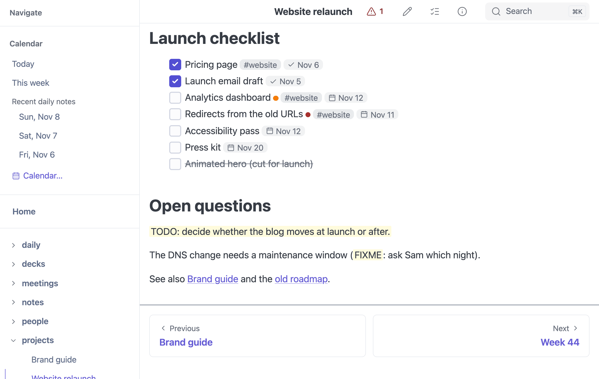

# Tasks

mbr extends GitHub's task lists with two extra markers and a small set of
annotations, all of which render as chips, pills and dots rather than as raw
text. The same syntax feeds the [task browser](../features/tasks/), which finds
every task in the repository and lets you filter and group them.

## Markers

| Marker | Status | Meaning |
|--------|--------|---------|
| `- [ ]` | Open | Not done yet |
| `- [x]` | Done | Completed (`- [X]` works too) |
| `- [-]` | Canceled | Abandoned — struck through, and never counted in a progress bar |
| `- [>]` | Canceled | Moved somewhere else; see [move markers](#move-markers) |

Any list bullet works — `-`, `*`, `+`, `1.` or `1)` — and a task may be
indented under another one. Nested tasks are treated as independent tasks: mbr
does not roll a parent's progress up from its children.

```markdown
- [ ] Unchecked task
- [x] Completed task
- [-] Canceled task
* [ ] Parent task
	* [ ] A subtask, counted on its own
```

## Live Example

- [ ] Write documentation
- [x] Set up project structure
- [-] Use complex build system (not needed!)

## Annotations

Annotations may appear anywhere in a task's text. They are lifted out of the
displayed text and rendered as their own elements, so the line stays readable.

| Syntax | Meaning | Notes |
|--------|---------|-------|
| `@due(<date>)` | Due date | Rendered as a calendar chip |
| `@done(<date>)` | Completion time | Rendered as a ✓ chip |
| `#tag` | Tag | `A–Z`, `a–z`, `0–9`, `_` and `-`; must follow a space or start the text |
| `!!` | High priority | An orange dot |
| `!!!` | Urgent | A red dot; wins over `!!` |

Obsidian Tasks emoji (`📅 2026-08-05`), Dataview fields (`[due:: 2026-08-05]`)
and org / Logseq `SCHEDULED:` / `DEADLINE:` lines are read too; see [Dates from
other tools](#dates-from-other-tools).

```markdown
- [ ] Write the report !! #work @due(2026-08-05)
- [x] File the receipts #admin @done(2026-08-04 12:11 PM)
- [ ] Ship the release !!! #release @due(2026-08-04 15:00)
```

Live:

- [ ] Write the report !! #work @due(2026-08-05)
- [x] File the receipts #admin @done(2026-08-04 12:11 PM)
- [ ] Ship the release !!! #release @due(2026-08-04 15:00)

A few rules worth knowing:

- **`#tag` needs whitespace in front of it.** That is what keeps
  `page.md#anchor` from becoming a tag.
- **`!!` needs whitespace on both sides** (or the end of the line), so `wow!!`
  is emphasis, not a priority.
- **A tag is one word.** `#in-progress` and `#in_progress` are tags;
  `#in progress` is the tag `#in` followed by the word "progress".
- **There is no low priority.** Normal is the default and draws no dot.



*Tasks as mbr draws them, with a `TODO:` and a `FIXME` marker below.*

## Date formats

`@due(...)` and `@done(...)` take the same grammar:

| Form | Example |
|------|---------|
| Date only | `@due(2026-08-05)` |
| Date + 24-hour time | `@due(2026-08-05 15:00)` |
| Date + 12-hour time | `@due(2026-08-05 03:00 PM)` |

Dates are **naive and local**: mbr does no timezone conversion and no UTC
round trip, so `2026-08-05 09:00` means nine in the morning wherever you are.
A due date with no time is treated as the start of that day, and a task is
overdue only once that whole day has passed — a task due today at 09:00 still
reads as "Today" at five in the afternoon.

> [!NOTE]
> An annotation whose contents are not a date is **not** an annotation.
> `@due(next tuesday)` stays in the text exactly as written, so a mistyped date
> shows up as your typo rather than as a task that quietly lost its deadline.

## Move markers

When a task moves to another note — most often a dated daily note — record
where it went with a trailing `> DATE`, and where it came from with a trailing
`< DATE`:

```markdown
- [>] Draft the agenda > 2026-08-06
- [ ] Draft the agenda < 2026-08-04
```

Both markers are stripped from the displayed text. The `>` form marks the task
canceled (it lives somewhere else now) and its destination date is kept and
shown as a → chip; the `<` form is recognised only so it does not clutter the
display, and is otherwise discarded.

## Dates from other tools

Vaults kept with other tools write task dates their own way. mbr reads these
too, strips them from the task's text, and shows them as the same chips as
`@due(...)`. It never rewrites them; the only thing it writes is the done stamp
described in [Editing tasks](#editing-tasks).

**Obsidian Tasks emoji**

```markdown
- [ ] File the report ⏫ 📅 2026-10-31
- [ ] Plan the trip ⏳ 2026-10-30 🛫 2026-10-01 ➕ 2026-09-15
- [x] Pay the invoice 📅 2026-10-20 ✅ 2026-10-19
- [-] Old idea ❌ 2026-10-18
```

| Emoji | Read as |
|-------|---------|
| `📅` (also `📆`, `🗓️`) | Due date |
| `⏳` (also `⌛`) | Scheduled date |
| `✅` | Done date |
| `❌` | Cancelled date (a chip only; the checkbox still decides the status) |
| `🛫` start, `➕` created | Hidden from the text, not used |
| `🔺` | Urgent, like `!!!` |
| `⏫`, `🔼` | High, like `!!` |
| `🔽`, `⏬` | No priority (mbr has no level below normal); hidden from the text |

Tasks has five priority levels and mbr has three, so medium (`🔼`) counts as
high: it ranks above an unmarked task. A priority emoji counts only on its own,
separated by spaces, as `!!` does. Recurrence (`🔁 every week`) stays in the
text.

**Dataview inline fields**

```markdown
- [ ] Call the bank [due:: 2026-10-31]
- [ ] Draft the talk (scheduled:: 2026-10-30T09:30)
- [x] Renew the passport [completion:: 2026-10-12]
```

`[due:: …]`, `[scheduled:: …]`, `[completion:: …]` and `[cancelled:: …]` are
read; `[created:: …]` and `[start:: …]` are hidden but not used. Square brackets
or parentheses both work. Keys must be lowercase. A value takes the same date
forms as `@due(...)`, plus Dataview's `2026-10-30T09:30`. Other fields, such as
`[priority:: high]`, stay in the text.

**Org mode and Logseq planning lines**

```markdown
- [ ] Ship the release
  SCHEDULED: <2026-10-31 Sat>
- [ ] Submit the grant
  SCHEDULED: <2026-10-28 Wed 09:00 +1w> DEADLINE: <2026-11-02 Mon>
```

`DEADLINE:` is the due date and `SCHEDULED:` the scheduled date. A planning
line counts only on the lines directly after a checkbox task, before any other
text in the item; elsewhere it is ordinary text. Repeaters and warning periods
(`+1w`, `.+1d`, `-2d`) are ignored. Org's `CLOSED: […]` is recognised and
hidden, but its date is not used. Logseq's `TODO` / `DONE` keyword items are
not checkbox tasks: a `TODO` is an [incomplete marker](#incomplete-markers), and
markers do not take planning dates.

**When a line has several.** The first due date in the line wins, whatever its
notation: in `- [ ] a 📅 2026-10-31 @due(2026-11-30)` the task is due on
October 31. A planning line comes after the task line, so a due date on the
task line wins over `DEADLINE:`.

**Scheduled dates** show as their own chip, in the document and in the panel.
They do not change which task is overdue or which [By Due](../features/tasks/#by-due) bucket it
falls in; only the due date does.

NotePlan's trailing `> 2026-11-03` is still read as "moved to that day", as
before, not as a due date.

## Incomplete markers

Not every loose end gets a checkbox. A sentence like

```markdown
The market fell 10% (source: TK).
```

is unfinished work too. mbr highlights it in the page and the
[task browser](../features/tasks/#incomplete-markers) lists it beside your real
tasks.

Any line containing one of the `incomplete_markers` — `TK`, `TODO`, `FIXME` or
`XXX` by default — becomes a **marker** entry. Matching happens *anywhere* in
the line, not just at the start, and is case-sensitive and word-boundaried, so
`TODO` matches but `Tomato` and `todo` do not.

Markers are skipped where the word is obviously not a note to self:

- inside inline code spans — `` `TODO` `` is documentation, not a task
- inside fenced and indented code blocks
- in the target of a `[[wikilink]]` (the alias half is ordinary text, so it
  still counts)
- in a link or image destination or title
- in link reference definitions, and in YAML frontmatter

A line is only ever **one** entry. `- [ ] TODO: ship it` is a task, never also
a marker — the checkbox wins.

On the page, the marker word gets a yellow wash (a paragraph, heading, list
item or table cell that *starts* with a marker, like `TODO: call Bob`, is washed
whole) and an anchor, `#mbr-marker-{line}`, that the task browser links to. The
marker list, the match rule and the per-mode defaults (on in server and GUI,
off in static builds) are in
[Incomplete-Marker Highlighting](../reference/configuration/#incomplete-marker-highlighting).

## Where tasks are and are not found

mbr scans markdown files line by line and skips fenced code
blocks, indented code blocks, HTML blocks and YAML frontmatter — so a `- [ ]`
inside an example like the ones above is documentation, not a task.

## Editing tasks

With [editing](../features/editing/) enabled, checkboxes in a rendered page become
clickable: a left click completes or reopens a task, and a right click cancels
it. Only the marker byte (and the `@done(...)` stamp) is rewritten; your
indentation, bullet style, spacing, other annotations and line endings are left
exactly as you wrote them. See the
[task browser](../features/tasks/#toggling-a-task) for the same thing from the
panel, and
[`tasks_stamp_done`](../reference/configuration/#task-settings) for the stamp.
