# iPhone and iPad

**MBR for iOS and iPadOS** reads a folder of markdown notes where it already
is (in iCloud Drive, on the device, in Working Copy or Dropbox) and shows it
with the same renderer and the same pages as mbr on the desktop. Nothing is
copied and nothing is uploaded: the app has no server and opens no network
port. It renders each page on the device, the moment you open it.

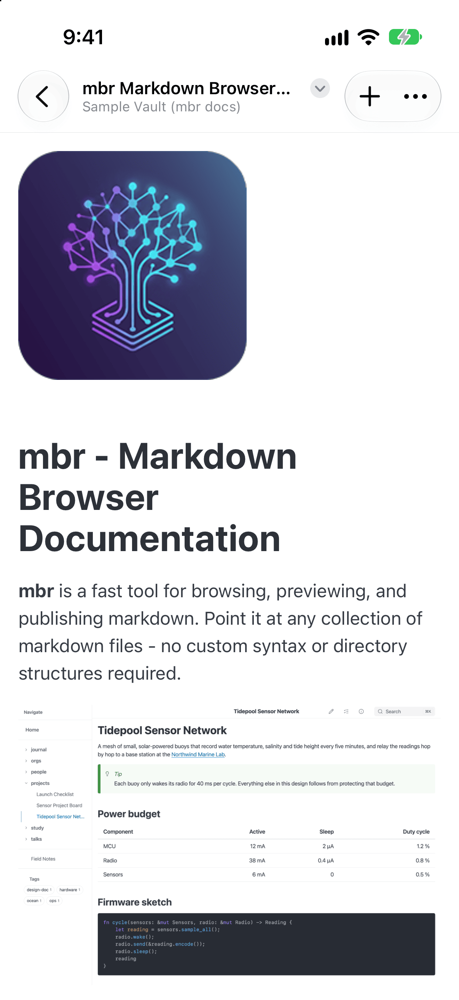

*A note in the iPhone app.*

The app needs iOS or iPadOS 26. Until it is on the App Store it is built from
source; see [Building the iOS App](../reference/ios-development/).

## Opening your notes

The vault list starts with **Sample Vault (mbr docs)**: this documentation,
bundled with the app and copied into the app's own folder (visible in Files
under *On My iPhone › MBR*) the first time you open it. It is a safe place to
try editing, tasks and flashcards.

Tap **+** on the vault list, pick the folder that holds your notes, then tap
**Open**. That folder is now a **vault**: it stays in the list, and the app
remembers its permission, so it opens straight away next time. Long-press a
vault to rename it (only the name shown in MBR changes) or remove it (the
folder itself is never deleted).

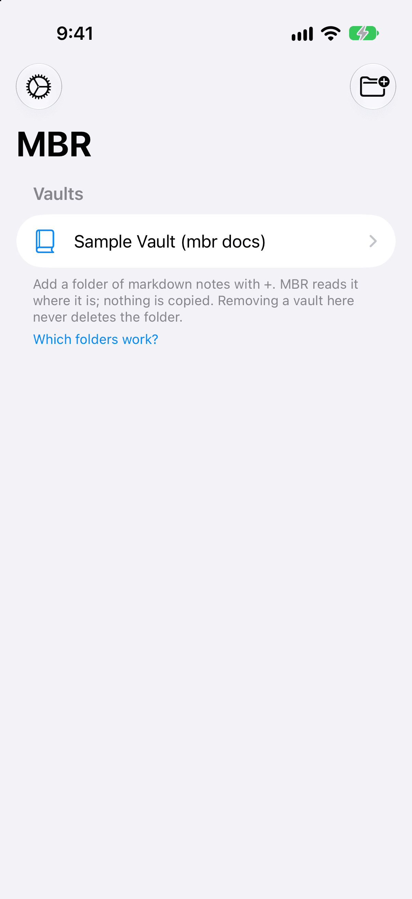

**Which folders work.** The folder picker shows every place iOS can share, but
not every provider can share a whole folder with another app:

| Works | Single files only |
|-------|-------------------|
| iCloud Drive (including a Mac's `~/Notes` synced there) | Google Drive |
| On My iPhone / iPad | OneDrive |
| Working Copy (git repositories) | Sync.com |
| Dropbox (changes made elsewhere appear once Dropbox has synced them) | |

**One file at a time.** From the Files app (or any app's Share sheet), choose
**Open in MBR** to read a single note. Links to other notes and images beside
it will not work, since the app can see only that file; tap **Grant Folder
Access…** to open the folder around it as a vault, at the same note.

## Getting around

MBR's web header is replaced by the iOS bar:

| Control | What it does |
|---------|--------------|
| **Title** | The page's title. Tap it for the breadcrumb menu: the folders above the page |
| **‹ Back** | The previous page. Long-press for your recent pages |
| **+** | A new note in the current folder (when editing is possible) |
| **⋯** | The page's actions: Search, Browse, Info, Contents, Links Out, Links In, Edit, Tasks, Today's Note, Calendar, Day Panel, Flashcards, Slides — whichever apply to the page — then Refresh, Home, Settings and Open Other Vault… |

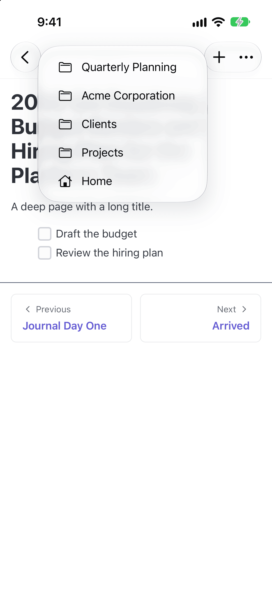

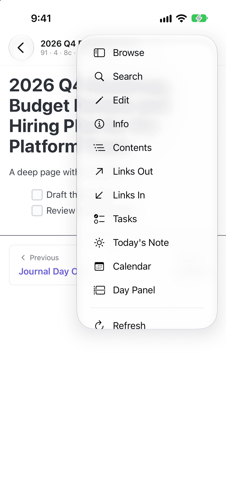

**Edge swipes.** Swipe in from the **left** edge of the screen to open the file
browser, and from the **right** edge for the info panel. (WebKit's own
back/forward swipes are off, so Back is always the bar's button.)

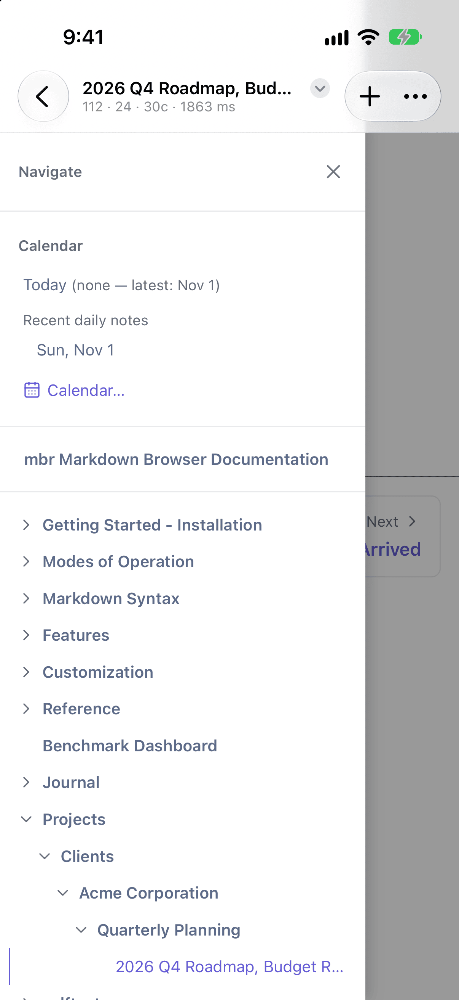

**Search** (⋯ → Search) opens a native search sheet with the keyboard already
up. It searches titles, frontmatter and the text of every note, like
[search on the desktop](../features/search/); tap a result to open it.

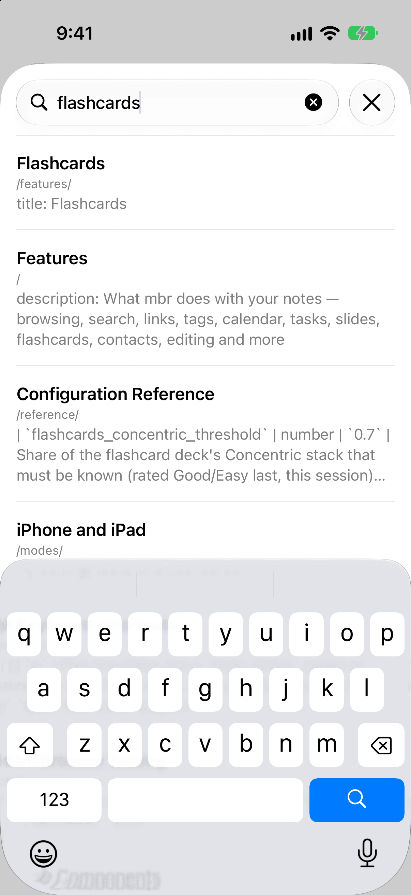

## What works

Everything that reads your notes works as it does on the desktop:
[browsing](../features/browsing/), [links and backlinks](../features/links/),
[tags](../features/tags/), the [calendar](../features/calendar/) and day
companion, [slides](../features/slides/) (full screen, swipe between slides),
[contacts](../features/contacts/) and [relationship charts](../features/relationships/),
[kanban](../features/kanban/), media, math and diagrams.

Writing works too:

| Feature | Notes |
|---------|-------|
| [Editing](../features/editing/) | Edit from ⋯ → Edit, new notes from **+**. The editor covers the screen and hides the bar until you save or cancel |
| [Tasks](../features/tasks/) | Tap a checkbox to complete a task; ⋯ → Tasks opens the task browser |
| [Flashcards](../features/flashcards/) | Including spaced repetition, which records each review in the note |
| [Review notes](../features/review/) | With a hardware keyboard (`r` on a selection) |

Every write goes through iOS's file coordination, so a sync provider sees it
as an ordinary edit. If a note changed somewhere else since the page was shown,
MBR refuses the write rather than overwrite the other change, and offers to
reload.

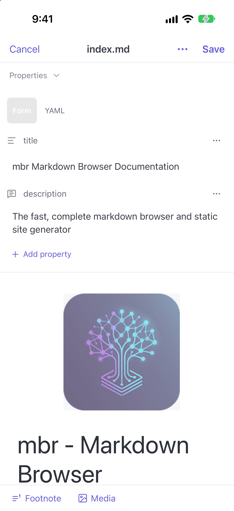

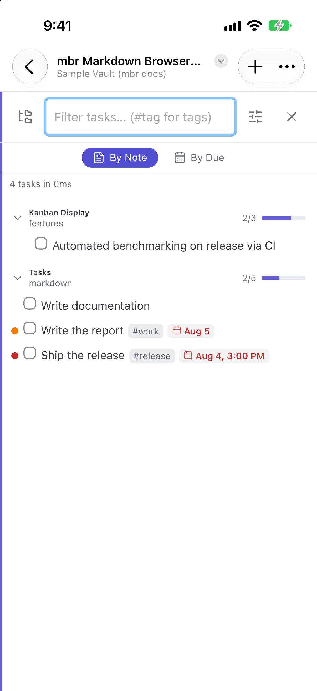

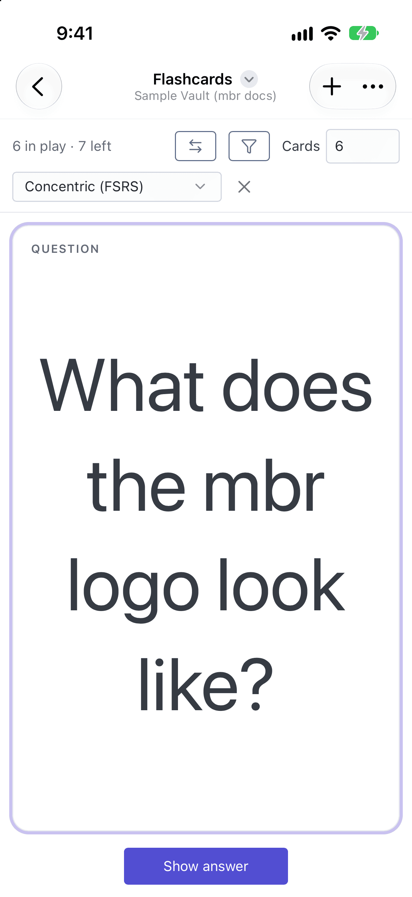

## Staying up to date

There is no live reload on iOS. Instead MBR checks the folder for changes:

- when you come back to the app,
- when you choose ⋯ → **Refresh**.

If the page on screen changed, or notes were added or removed, the page
reloads by itself. Changes to `.mbr/` (configuration, templates, CSS) are
picked up the same way.

## iCloud and other cloud folders

Cloud providers often keep only the *names* of files on the device until
something opens them. MBR handles this:

- **A note that is not downloaded yet** shows a "Downloading from iCloud…" page
  with the note's name. MBR asks for the file and the page appears by itself
  when it arrives.
- **Offline**, that page says so ("You're offline") and the note downloads once
  you are back online.
- **A folder that has never been opened on this device** may list only some of
  its files at first. MBR asks for the rest, and refreshes until they arrive.
- **Search** skips notes that are not downloaded, and says how many it skipped.

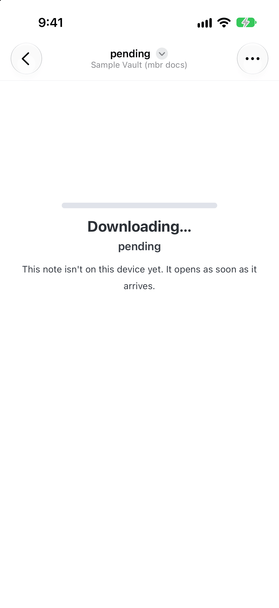

For reading offline, and for the fastest start, keep the vault downloaded: in
the Files app, long-press the vault folder and choose **Keep Downloaded**.

## Customizing

A vault's [`.mbr/` folder](../customization/) works on iOS: `config.toml`,
templates, `theme.css`, `user.css` and components. If `config.toml` cannot be
read, the vault still opens, with the defaults, and the app shows a
**Configuration ignored** notice with the reason (the page-problems panel
lists it too). Fix the file and refresh.

Settings that make no sense on a phone are fixed: there is no server, so
`port`, `host` and the edit token are ignored, and link previews (oEmbed) are
off.

## Settings

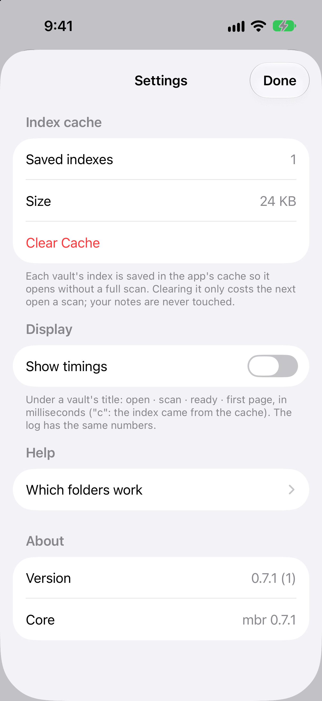

| Setting | What it does |
|---------|--------------|
| **Index cache** | Each vault's index is saved in the app's own cache so it opens without a full scan. **Clear Cache** costs the next open a scan; your notes are never touched |
| **Show timings** | Shows open · scan · ready · first page times, in milliseconds, under a vault's title |
| **Which folders work?** | The provider list above |

## Privacy and storage

- The app reads only folders you pick, through iOS's security-scoped
  permissions.
- The only thing it writes outside your notes is the index cache, in its own
  `Caches` directory, which iOS may clear at any time.
- It makes no network requests of its own. Images and videos your notes embed
  from the web load as they would in Safari.

## Troubleshooting

| Problem | Try |
|---------|-----|
| A folder looks empty or half empty | Wait for the refresh, or open the folder once in the Files app; keep it downloaded for offline use |
| "Downloading…" never finishes | Check you are online and signed in to the provider; open the file in the Files app |
| "Configuration ignored" | The notice gives the parse error; fix `.mbr/config.toml` and choose Refresh |
| An edit was refused | The note changed elsewhere; reload and make the edit again |
| Google Drive or OneDrive folder cannot be picked | Those providers share single files only; use **Open in MBR** on a file |
